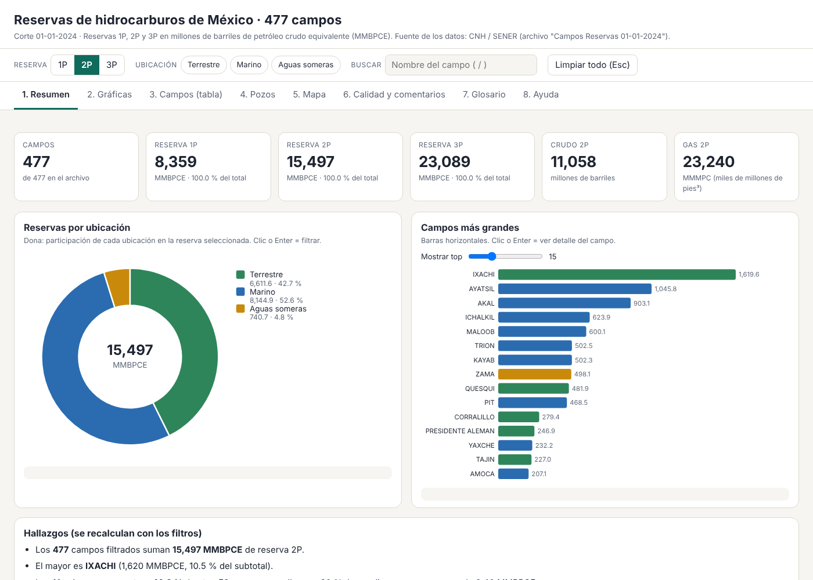

# Reservas de hidrocarburos de México · 477 campos (corte 01-01-2024)

Aplicación web para explorar, limpiar, consultar y visualizar las reservas de hidrocarburos de México (1P, 2P y 3P) por campo, junto con los pozos asociados (estado activo/inactivo, profundidades y comparador). Genera reportes PDF con estadísticas, gráficas y conclusiones. Proyecto final de *Diseño de Aplicaciones para Análisis de Datos*.



## Contexto y objetivo
Las reservas indican cuánto hidrocarburo se puede producir y dónde se concentra, pero la información oficial se publica en tablas extensas por campo, difíciles de explorar. Además, 1P, 2P y 3P expresan distintos niveles de certeza, y un campo puede tener pocas reservas probadas frente a las posibles. La aplicación convierte esos datos en una herramienta interactiva para responder preguntas como: ¿qué tan concentradas están las reservas?, ¿dónde están y qué fluido predomina?, ¿qué tan segura es la reserva? y ¿cuántos pozos siguen activos? (ver `docs/preguntas_de_analisis.md`).

## Datos
| | Reservas por campo | Pozos |
|---|---|---|
| Fuente | CNH / SENER: [ENLACE EXACTO DE DESCARGA] | Capa «Pozos, 2024» (CNH/CNIH) alojada en SEMARNAT: https://geomaticasig1.semarnat.gob.mx/arcgis/rest/services/Hosted/Pozos_2024/FeatureServer/0 |
| Archivo original (sin modificar) | `data/raw/Campos_Reservas_01-01-2024.csv` | `data/external/pozos_arcgis_crudo.csv` |
| Registros · atributos | 477 · 22 | 34,147 · 17 |
| Fecha | Corte al 01-01-2024 | Descargado el [FECHA] con `scripts/05_descargar_pozos_arcgis.py` |
| Datos de trabajo | `data/processed/` (script 01) | `data/external/pozos.csv`, 16 columnas (script 03) |

Los archivos originales no se modifican: toda limpieza genera archivos nuevos. Son datos públicos reales, sin información personal. Se eligieron porque combinan variables numéricas (reservas, profundidades) y categóricas (ubicación, estado, clasificación) y permiten estudiar concentración, incertidumbre y actividad. La profesora autorizó trabajar con menos de 50,000 registros ([MEDIO Y FECHA DE LA AUTORIZACIÓN]).

## Estructura
```
data/raw/        CSV original de reservas, sin modificar
data/external/   pozos_arcgis_crudo.csv (original de pozos, sin modificar) · pozos.csv (normalizado)
                 coordenadas_campos.csv · pozos_plantilla.csv
data/processed/  CSV/JSON limpios, resúmenes y cobertura de pozos por campo
data/export/     campos.txt · pozos.txt (TXT con tabuladores) · reservas.db (SQLite; no se versiona, lo genera el script 09)
scripts/         01_limpieza_analisis.py · 02_build_web.py · 03_normalizar_pozos.py
                 05_descargar_pozos_arcgis.py · 06_coordenadas_campos_desde_pozos.py
                 07_descargar_poligonos_campos.py (opcional) · 09_formatos_txt_sqlite.py
tests/           test_05_arcgis_simulado.py (prueba del descargador sin internet)
web/             template.html (fuente) e index.html (generado, un solo archivo)
docs/            glosario, hallazgos, fuente del mapa, guía de pozos, plan de commits, capturas
.vscode/         tareas, depuración y extensiones recomendadas
```

## Uso rápido
Requiere Python 3.10 o superior. Los datos ya vienen en el repositorio, así que no hace falta internet para ejecutarlo.
```bash
pip install -r requirements.txt
python3 scripts/01_limpieza_analisis.py   # limpia y calcula  (en Windows: python)
python3 scripts/02_build_web.py           # genera web/index.html
# abre web/index.html en el navegador (o Live Server en VS Code)
```
Para repetir todo el proceso de datos: 01 → 05 (internet) → 03 → 06 → 09 `exportar` → 02.

## Pozos
El CSV de reservas no trae pozos, pero el mapa de la CNH sí tiene la ficha de cada uno (campo, entidad, clasificación, estado actual, profundidades, fechas…). Al elegir un campo en el dashboard se despliegan sus pozos y se pueden comparar.
```bash
python3 scripts/05_descargar_pozos_arcgis.py        # baja los pozos (necesita internet)
python3 scripts/03_normalizar_pozos.py data/external/pozos_arcgis_crudo.csv
python3 scripts/02_build_web.py                     # o carga el CSV desde la pestaña Pozos
```

La normalización conserva todos los pozos; solo elimina filas idénticas en todas sus columnas (hoy, ninguna). Hay 15 pares de pozos que comparten nombre y campo pero son distintos (coordenadas, fechas y profundidades diferentes).

### Importar y exportar formatos (CSV, TXT, SQLite)
```bash
python3 scripts/09_formatos_txt_sqlite.py exportar                       # crea data/export/
python3 scripts/09_formatos_txt_sqlite.py importar --txt mis_pozos.txt   # TXT delimitado -> pozos.csv
python3 scripts/09_formatos_txt_sqlite.py importar --db data/export/reservas.db
python3 scripts/09_formatos_txt_sqlite.py consulta "SELECT ubicacion, COUNT(*) FROM campos GROUP BY 1"
```
`data/export/reservas.db` no está en el repositorio, porque sus bytes cambian en cada corrida aunque los datos sean los mismos. Créalo con el primer comando (`exportar`) antes de usar `importar --db` o `consulta`.

Detalles, límites y cómo encontrar el servicio si cambia: `docs/pozos.md`. 

## Qué incluye el dashboard
Dona y pastel, barras (simples, agrupadas, apiladas), histograma, dispersión log-log, Pareto, tabla ordenable con descarga CSV/JSON, pozos por campo con estado, clasificación, profundidades, días de perforación y comparador (hasta 6), mapa Leaflet con campos y pozos por estado, calidad de datos y glosario. Todo responde a filtros y teclado: `P` (1P/2P/3P), `U` (ubicación), `/` buscar, `Esc` limpiar, `1`–`9` pestañas, flechas + Enter dentro de las gráficas.

## Limitaciones
- Sin pozos cargados solo 7 campos tienen coordenadas, y son referenciales (±50 km o más). Con los pozos cargados, cada campo se ubica solo en el centro de sus pozos (`scripts/06_…` lo guarda en CSV). El mapa muestra puntos, no contornos: para eso haría falta un shapefile/GeoJSON (ver `docs/fuente_mapa.md`).
- El mapa base necesita internet (OpenStreetMap vía Leaflet en cdnjs).
- Las columnas de volumen original 2P/3P parecen incrementales: confirmar en la nota metodológica de la CNH.

## Pruebas
```bash
python3 tests/test_01_limpieza.py          # calidad de los datos de reservas (requiere haber corrido el script 01)
python3 tests/test_03_normalizar_pozos.py  # normalización de pozos
python3 tests/test_05_arcgis_simulado.py   # descargador de pozos, contra un servidor simulado
```

## En VS Code
Abre la carpeta, acepta las extensiones recomendadas, `Ctrl+Shift+B` ejecuta limpieza + build, clic derecho en `web/index.html` → *Open with Live Server*.

## Autoría y licencia
- **Autor:** Emmanuel Vázquez Alfaro (emmanuelvazquezalfaro123@gmail.com) y Gustavo Angel Nava Bautista (navagustavo484@gmail.com) · © 2026. Todos los derechos reservados (ver `LICENSE`).
- El código, el análisis y la documentación son de autoría propia; los datos son públicos de la CNH y SENER y no están cubiertos por la licencia.
- La autoría queda registrada en el historial de commits de Git (autor y fecha de cada cambio).
- Los nombres de los autores aparecen en el pie de la aplicación, en cada reporte PDF generado (autores y aviso de derechos) y en el encabezado de los scripts.
