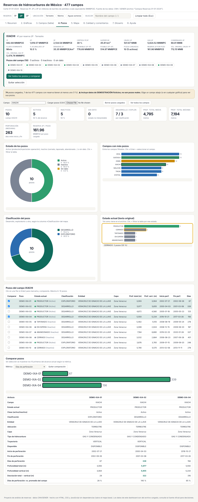

# Reservas de hidrocarburos de México · 477 campos (corte 01-01-2024)

Análisis y dashboard interactivo de las reservas 1P, 2P y 3P por campo (CNH/SENER), con módulo de pozos (estado activo/inactivo y comparador).


## Estructura
```
data/raw/        CSV original, sin modificar
data/processed/  CSV/JSON limpios + resumen.json (los genera 01_limpieza_analisis.py)
data/external/   coordenadas_campos.csv (referencial) · pozos_plantilla.csv · pozos.csv (generado al normalizar)
data/demo/       pozos_DEMO_ficticio.csv (pozos FICTICIOS para probar la interfaz)
scripts/         01_limpieza_analisis.py · 02_build_web.py · 03_normalizar_pozos.py · 04_generar_demo_pozos.py
                05_descargar_pozos_arcgis.py
tests/           test_05_arcgis_simulado.py (prueba del descargador sin internet)
web/             template.html (fuente) e index.html (generado, un solo archivo)
docs/            glosario, hallazgos, fuente del mapa, guía de pozos, plan de commits, capturas
.vscode/         tareas, depuración y extensiones recomendadas
```

## Uso rápido
```bash
pip install -r requirements.txt
python3 scripts/01_limpieza_analisis.py   # limpia y calcula  (en Windows: python)
python3 scripts/02_build_web.py           # genera web/index.html
# abre web/index.html en el navegador (o Live Server en VS Code)
```

## Pozos
El CSV de reservas no trae pozos, pero el mapa de la CNH sí tiene la ficha de cada uno (campo, entidad, clasificación, estado actual, profundidades, fechas…). Al elegir un campo en el dashboard se despliegan sus pozos y se pueden comparar.
```bash
python3 scripts/05_descargar_pozos_arcgis.py        # baja los pozos (necesita internet)
python3 scripts/03_normalizar_pozos.py data/external/pozos_arcgis_crudo.csv
python3 scripts/02_build_web.py                     # o carga el CSV desde la pestaña Pozos
```
Detalles, límites y cómo encontrar el servicio si cambia: `docs/pozos.md`. Para probar la interfaz sin internet: pestaña Pozos → cargar `data/demo/pozos_DEMO_ficticio.csv` (pozos **ficticios**).



## Qué incluye el dashboard
Dona y pastel, barras (simples, agrupadas, apiladas), histograma, dispersión log-log, Pareto, tabla ordenable con descarga CSV/JSON, pozos por campo con estado, clasificación, profundidades, días de perforación y comparador (hasta 6), mapa Leaflet con campos y pozos por estado, calidad de datos y glosario. Todo responde a filtros y teclado: `P` (1P/2P/3P), `U` (ubicación), `/` buscar, `Esc` limpiar, `1`–`8` pestañas, flechas + Enter dentro de las gráficas.

## Limitaciones
- Solo 7 campos tienen coordenadas, y son referenciales (±50 km o más). Carga las reales (`nombre,lat,lon`) desde la pestaña Mapa.
- El mapa base necesita internet (OpenStreetMap vía Leaflet en cdnjs).
- Las columnas de volumen original 2P/3P parecen incrementales: confirmar en la nota metodológica de la CNH.

## En VS Code
Abre la carpeta, acepta las extensiones recomendadas, `Ctrl+Shift+B` ejecuta limpieza + build, clic derecho en `web/index.html` → *Open with Live Server*.
